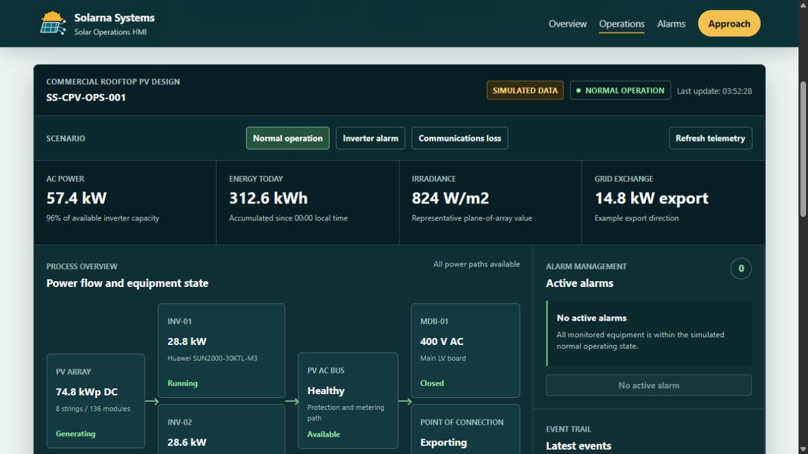

# Solarna Systems

Electrical engineering, automation, and technical software, founded by
Majd Ben Chobba.

[Services and contact](https://solarnasystems.com/) ·
[Try the solar HMI prototype](https://solarnasystems.com/samples/solar-operations-hmi.html) ·
[Open SolarnaPV](https://pv.solarnasystems.com/)

*Public HMI prototype, captured 24 September 2026. All displayed telemetry is
simulated. It is not connected to field equipment and sends no plant commands.*

## Engineering and delivery

- Solar PV studies, electrical system design, equipment schedules, and documentation.
- PLC operating sequences, interlocks, alarm logic, and commissioning support.
- Monitoring interfaces, data integration, and technical web applications.

A project moves from assessment and an agreed scope through implementation,
review, and handover. [Discuss a project](https://solarnasystems.com/#contact)
with the required output, equipment, and timeline.

## SolarnaPV

[SolarnaPV](https://pv.solarnasystems.com/) is a PV site-analysis and production
planning application. Its source, documentation, mobile shells, and offline tests
are in [`SolarnaPV/`](SolarnaPV/README.md). The MIT license in that directory
covers the SolarnaPV application and its documentation. It does not license the
company showcase artwork in `assets/` or grant rights to the Solarna Systems
name or marks.

The model estimates fixed-panel energy from PVGIS weather data. It is a research
and planning tool, not a certified roof design or a substitute for site survey,
structural review, or field validation. Read the
[model assumptions and validation status](SolarnaPV/README.md#model-and-assumptions)
before using its results.

## Other work

[Solara](https://usesolara.pages.dev/) is a separate software-workspace product.
The [solar operations HMI](https://solarnasystems.com/samples/solar-operations-hmi.html)
and [illustrative rooftop design](https://solarnasystems.com/samples/commercial-rooftop-pv-demo.html)
are capability samples, not client projects or construction documents.
